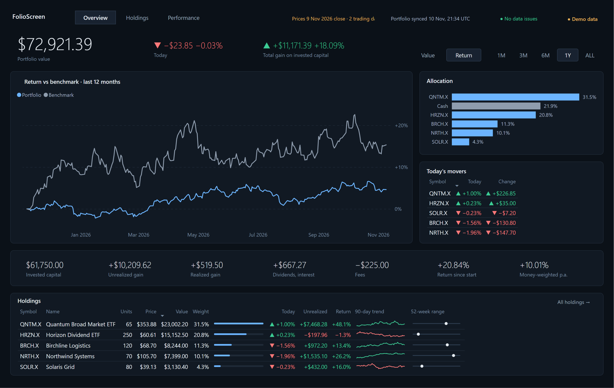
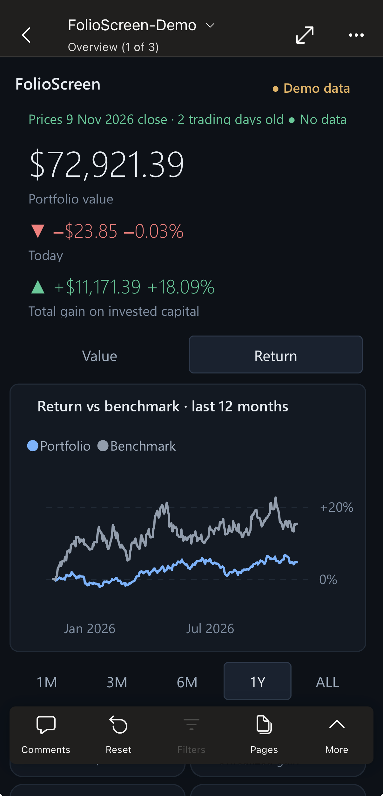

# FolioScreen

**A private investment portfolio dashboard in Power BI, built from your brokerage data on your own computer.**
Holdings, returns against a benchmark, contribution to gain, income, risk and data quality, on desktop and, with
layouts designed separately, on your phone. Free to run: a free Power BI workspace, SnapTrade Personal and Tiingo's
free tier.

<p>
  
  
</p>

> **Preview.** Everything here works and is tested on macOS, including the unattended nightly sync; a seven-night
> unattended run is in progress before the first stable release. Windows is supported and tested automatically on
> every change, but has not yet been run end to end on a Windows PC. See [the development guide](docs/development.md).

## What you get

| Page | Shows |
|---|---|
| **Overview** | Portfolio value, today's change and total gain; return against a benchmark or value over 1M / 3M / 6M / 1Y / ALL; allocation; today's movers; invested capital, unrealized and realized gain, income, fees, time- and money-weighted returns; holdings with 90-day trends and 52-week ranges |
| **Holdings** | Every position by account and type, with average cost, weight, today's move and unrealized gain; accounts; recent activity; data-quality checks |
| **Performance** | Return against the benchmark by period, value against net deposits, contribution to gain by security, income by month, largest fall, volatility, best and worst days, concentration |
| **Security detail** | Drill through from any holding: price history against your average cost, transactions, accounts, contribution and dividends |

Every page has a phone layout for the Power BI mobile app.

## How it works

**SnapTrade Personal** (read-only brokerage data) → nightly sync on your computer → reconciliation → your own Power BI
semantic model → Power BI refreshes daily **Tiingo** closing prices.

- **Nothing is estimated.** Holdings and cash are exactly what your brokerage reports; history is rebuilt from its
  transactions; anything that does not add up is shown in the Data quality panel, never corrected silently.
- **Every figure is checked.** `folio check-report` evaluates every measure in Power BI and compares each figure with
  an independent Python calculation; `folio verify` does the same for every day of history.
- **Safe by default.** Each sync is verified after it lands; if anything fails, the previous verified version is
  restored and the report keeps showing it, marked stale after 36 hours.

## Requirements

- **macOS** (developed and tested on the current release) or **Windows 10/11**
- **Python 3.11 or later** and **Git** (or GitHub Desktop)
- A Microsoft account that can use Power BI (the free *My workspace* is enough)
- For your own data: free SnapTrade Personal API keys and a free Tiingo API token

## Three ways to run it

| | What you need | What you see |
|---|---|---|
| **1. Demo** (start here) | A Microsoft account with Power BI | A fictional portfolio: every page complete |
| **2. Sandbox rehearsal** | + free SnapTrade Personal keys and a free Tiingo key | SnapTrade's simulated brokerage through the full pipeline, including the report's caution states |
| **3. Your own data** | + a read-only brokerage connection through SnapTrade | Your portfolio, private to you |

## Quick start (demo, about 10 minutes)

1. Download FolioScreen (step 1).
2. Set up Python once (step 2: commands differ on macOS and Windows).
3. Run `folio setup` (step 3).
4. Open the report (step 4).

### 1. Download FolioScreen

Keep it in a plain folder of your own: on macOS **not** in Desktop, Documents, Downloads or iCloud Drive (macOS stops
background jobs reading those); on Windows **not** in a OneDrive-synced folder (syncing a Python environment causes
conflicts).

**macOS (Terminal)**

```bash
mkdir -p ~/Developer && cd ~/Developer
git clone https://github.com/dmousouroulis/FolioScreen.git folioscreen
cd folioscreen
```

**Windows (PowerShell)**

```powershell
New-Item -ItemType Directory -Force "$HOME\Developer" | Out-Null
Set-Location "$HOME\Developer"
git clone https://github.com/dmousouroulis/FolioScreen.git folioscreen
Set-Location folioscreen
```

No Git? Install it with `winget install Git.Git` (Windows) or `xcode-select --install` (macOS), or use GitHub Desktop.

### 2. Set up Python (once)

**macOS (Terminal)**

```bash
python3 -m venv .venv
source .venv/bin/activate
pip install -r requirements.txt
```

**Windows (PowerShell)**

```powershell
py -m venv .venv
.\.venv\Scripts\Activate.ps1
pip install -r requirements.txt
```

If Windows says running scripts is disabled, allow your own scripts once, then activate again:
`Set-ExecutionPolicy -Scope CurrentUser RemoteSigned`. No Python yet? `winget install Python.Python.3.12` (Windows) or
the installer from [python.org](https://www.python.org/downloads/) (both).

Each time you open a new Terminal or PowerShell window, go to the folder and activate the environment again
(`source .venv/bin/activate` or `.\.venv\Scripts\Activate.ps1`). Every `python -m folio` command below is the same on
both systems.

### 3. Run setup

```text
python -m folio setup
```

`folio setup` checks each step, explains what it needs and why, and asks before doing anything. It signs you in to
Microsoft (once, in a browser), publishes the demo report, then asks whether you want to connect your own data. You
can stop after the demo. `python -m folio setup --check` shows what is set up and what is missing, changing nothing.

### 4. Open the report

Open [Power BI](https://app.powerbi.com) → **My workspace** → **FolioScreen-Demo**. On your phone, install the Power BI
app and sign in with the same account: the report opens in its phone layout.

## Connecting your own data

`folio setup` walks through this; here is what it asks you to do, and why.

1. **SnapTrade Personal API keys.** Create a SnapTrade account and generate Personal keys (a client ID and a consumer
   key) in its dashboard. FolioScreen only reads: it requests read-only connections and refuses any connection with
   trading access.
2. **Rehearse on the Sandbox.** Connect SnapTrade's simulated brokerage first (`folio connect --sandbox`). Its data is
   deliberately imperfect (some transactions contradict the holdings), so you will see performance marked
   *Unavailable* and the Data quality panel at work, before any real account is involved.
3. **Tiingo API token.** Create a free Tiingo account and copy your token. FolioScreen uses one request per ticker per
   refresh.
4. **One Power BI setting.** In the live model's settings, set the `api.tiingo.com` credential to *Anonymous* and tick
   *Skip test connection* (the token itself stays in the model, written from your credential store at each sync).
5. **Connect your brokerage** through SnapTrade's link (`folio connect`), read-only.
6. **First sync and the nightly schedule.** `folio sync` fetches, reconciles, publishes and verifies; `folio schedule
   install` runs it every night (default 21:30) with launchd on macOS or Task Scheduler on Windows. A run missed while
   the computer was asleep or off runs as soon as it is back, and anything that fails is rolled back automatically.
7. **Power BI's own price refresh.** Setup sets the model to refresh prices daily at 07:00 as well, so the report stays
   current when the computer is off. It runs well apart from the nightly sync (two refreshes at once compete), and
   Power BI emails you if it fails. Setup compares the two in real time zones (Power BI keeps its own) and sets the
   refresh in your time zone, so it follows daylight saving time.

SnapTrade's and Tiingo's plans, limits and terms are theirs and can change: check their current pages before you
sign up.

## Privacy and limits

- **Credentials** are typed into hidden prompts and kept only in your system's credential store (the macOS Keychain or
  Windows Credential Manager): never in files, logs or history.
- **What leaves your computer:** your reconciled holdings, cash and transactions go to *your* Power BI My workspace,
  private to you until you share it. Account identifiers are replaced by random keys before anything is written.
- **Refreshes:** a model in a free or Pro workspace may refresh 8 times in any rolling 24 hours, scheduled and
  on-demand together. Normal operation uses two (the nightly sync and Power BI's morning price refresh); a day of
  repeated deploys can use the rest, and Power BI then refuses refreshes and emails you until earlier ones age out.
- **Nothing is estimated.** Holdings and cash are exactly what the brokerage reports; history is rebuilt from its
  transactions; anything that does not add up is shown, never corrected silently.

## Commands you will use

```text
python -m folio setup [--check]      guided setup; --check reports what is set up and what is missing
python -m folio status               last sync, sign-in, schedule and credentials
python -m folio sync                 sync now (the same as the nightly run)
python -m folio check-report         every report figure against the Python reference
python -m folio connect [--sandbox]  read-only SnapTrade link to connect a brokerage
python -m folio auth login           Microsoft sign-in, if it ever expires
```

The sync log shows every run without amounts or holdings:

**macOS (Terminal)**

```bash
tail -40 ~/Library/Logs/FolioScreen/sync.log
```

**Windows (PowerShell)**

```powershell
Get-Content "$env:LOCALAPPDATA\FolioScreen\logs\sync.log" -Tail 40
```

## Updating FolioScreen

**macOS (Terminal)**

```bash
cd ~/Developer/folioscreen && git pull
source .venv/bin/activate && pip install -r requirements.txt
python -m folio setup --check
```

**Windows (PowerShell)**

```powershell
Set-Location "$HOME\Developer\folioscreen"; git pull
.\.venv\Scripts\Activate.ps1; pip install -r requirements.txt
python -m folio setup --check
```

Everything else, including how FolioScreen was tested phase by phase, is in the
[development guide](docs/development.md). The methods are in [docs/methodology.md](docs/methodology.md) and
[docs/reconciliation-policy.md](docs/reconciliation-policy.md).

## Disclaimer

FolioScreen is a personal tool provided as is, under the [MIT licence](LICENSE). It is not financial advice, and its
figures are not a substitute for your brokerage's statements. It is not affiliated with or endorsed by Microsoft,
SnapTrade or Tiingo; their names are used only to describe what FolioScreen connects to.

Security issues: please see [SECURITY.md](SECURITY.md).
